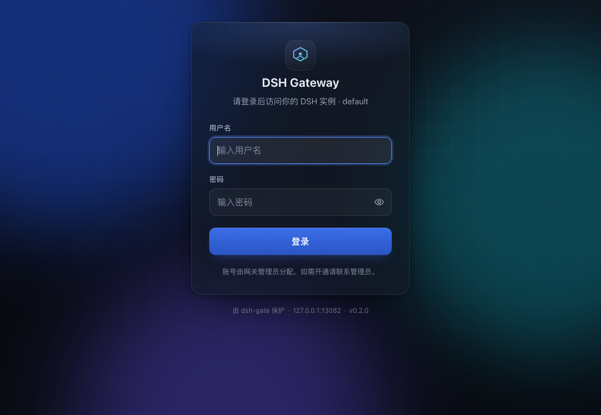
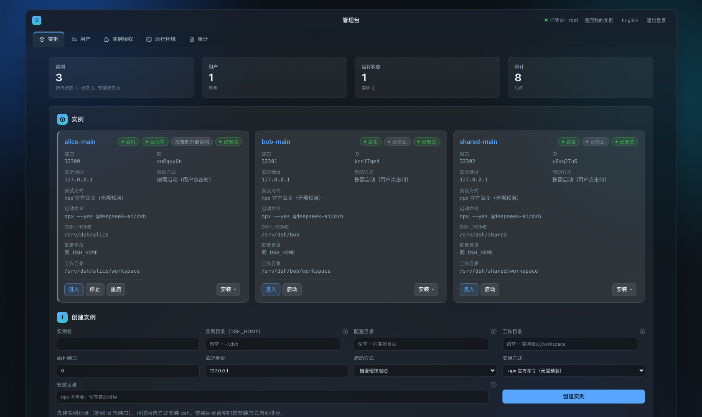
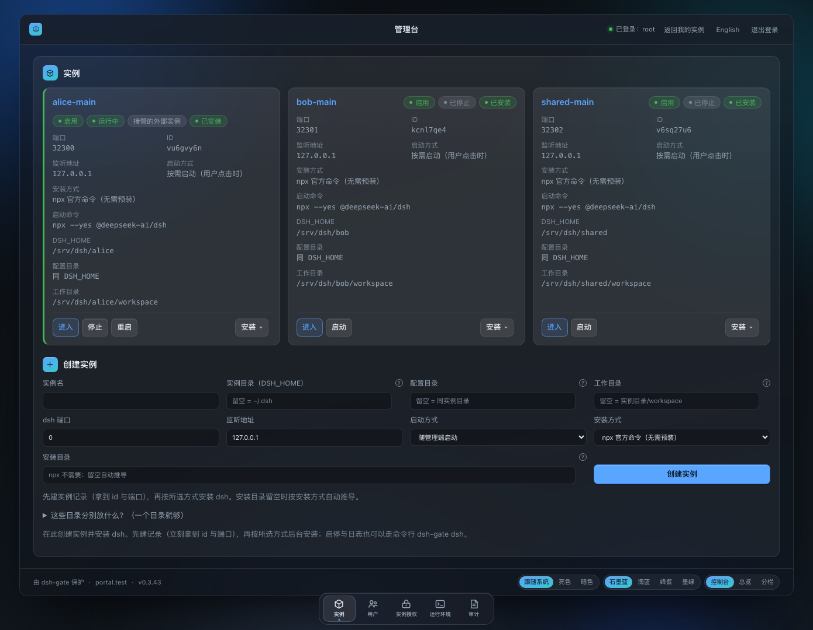
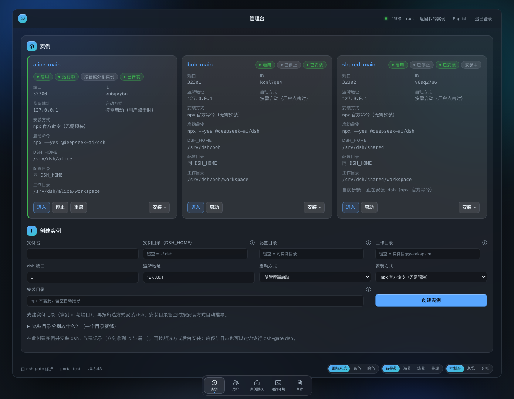
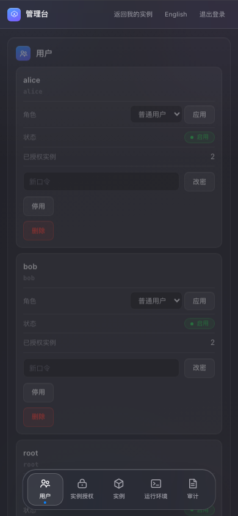
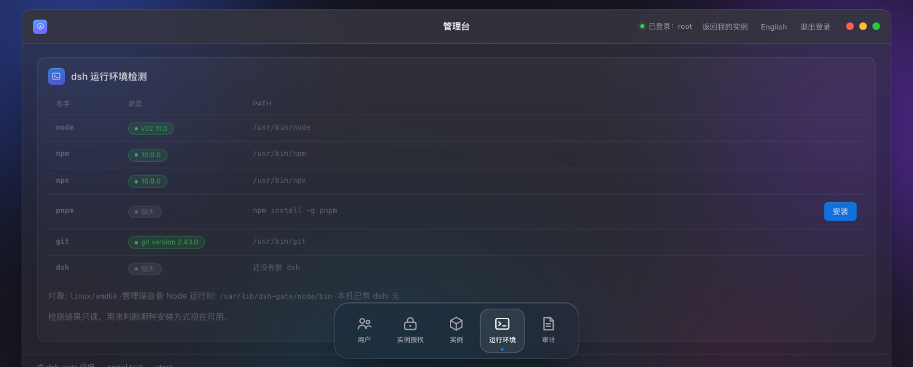
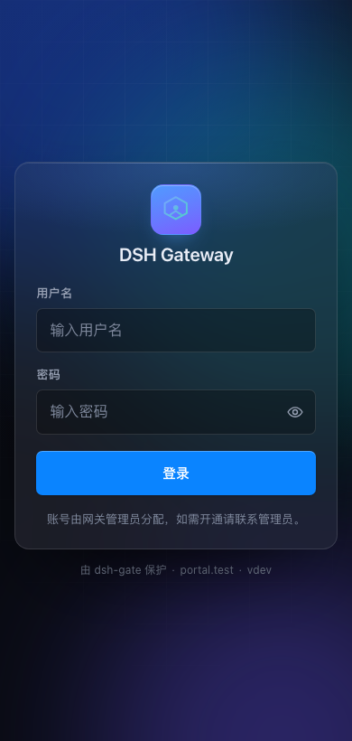
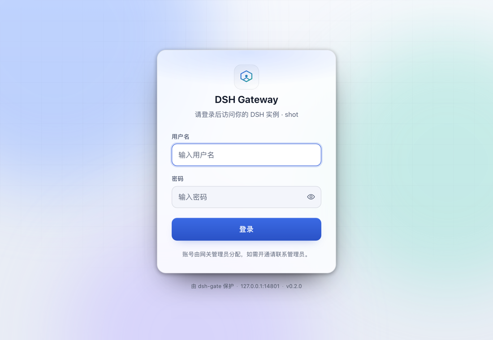

# dsh-gate

**A LAN / remote-access admin console for [DeepSeek Harness](https://deepseek-harness.github.io/deepseek-harness/guide/quickstart).**

A single-binary Go program that uses only the Go standard library (the SQLite driver behind the admin console is the one exception — see [go.mod](go/go.mod)). It serves a login page and an admin console on a LAN-reachable port, and once you are authenticated it reverse-proxies each request to the right local dsh instance. Instances are installed, started and lazily launched by the console, and each one has its own `DSH_HOME`.



<sub>Phone width and light mode are shown at the end of the Quick start section.</sub>

中文版：[README.md](README.md)

---

## Table of Contents

- [What problem it solves](#what-problem-it-solves)
- [How it works](#how-it-works)
  - [How instances start](#how-instances-start)
- [What it actually does](#what-it-actually-does)
- [Admin console: one entry point, many dsh instances](#admin-console-one-entry-point-many-dsh-instances)
  - [Installing dsh from the admin console](#installing-dsh-from-the-admin-console)
- [Getting started in 30 seconds](#getting-started-in-30-seconds)
  - [The login page on a phone, and in light mode](#the-login-page-on-a-phone-and-in-light-mode)
- [Tutorial](#tutorial)
  - [Step 0 — What you need](#step-0--what-you-need)
  - [Step 1 — Install the admin console](#step-1--install-the-admin-console)
  - [Step 2 — Create an instance and install dsh](#step-2--create-an-instance-and-install-dsh)
  - [Step 3 — Open it and log in](#step-3--open-it-and-log-in)
  - [Step 4 — Configure a model (works without any plugin)](#step-4--configure-a-model-works-without-any-plugin)
  - [Step 5 — Install the plugin (optional, recommended)](#step-5--install-the-plugin-optional-recommended)
  - [Step 6 — Day-to-day](#step-6--day-to-day)
  - [Step 7 — Removing it](#step-7--removing-it)
  - [Three places to look when something is wrong](#three-places-to-look-when-something-is-wrong)
- [Installation](#installation)
  - [Download a prebuilt binary](#download-a-prebuilt-binary)
  - [Build from source](#build-from-source)
  - [Cross-compiling and packaging](#cross-compiling-and-packaging)
- [Command reference](#command-reference)
  - [dsh-gate install](#dsh-gate-install)
  - [dsh-gate start](#dsh-gate-start)
  - [dsh-gate stop](#dsh-gate-stop)
  - [dsh-gate restart](#dsh-gate-restart)
  - [dsh-gate status](#dsh-gate-status)
  - [dsh-gate uninstall](#dsh-gate-uninstall)
  - [dsh-gate service](#dsh-gate-service)
  - [dsh-gate dsh](#dsh-gate-dsh)
  - [dsh-gate manage](#dsh-gate-manage)
  - [dsh-gate plugin](#dsh-gate-plugin)
  - [dsh-gate model](#dsh-gate-model)
  - [dsh-gate version](#dsh-gate-version)
- [Multiple instances](#multiple-instances)
- [Server deployment (Linux + systemd)](#server-deployment-linux--systemd)
- [Remote access (using your office DSH from home)](#remote-access-using-your-office-dsh-from-home)
  - [Option 1: a tunneling service (least effort)](#option-1-a-tunneling-service-least-effort)
  - [Option 2: an overlay network such as Tailscale or ZeroTier](#option-2-an-overlay-network-such-as-tailscale-or-zerotier)
  - [Option 3: the console serves HTTPS itself](#option-3-the-console-serves-https-itself)
- [Security notes](#security-notes)
- [Environment variables](#environment-variables)
- [FAQ](#faq)
- [Contributing](#contributing)
- [License](#license)

---

## What problem it solves

dsh's built-in web UI **listens on `127.0.0.1` only**. That is not an oversight; it is its security design: dsh authenticates with a random token generated at each start and printed to stdout, so only someone who can see that output on that machine gets it. In other words, dsh was never meant to be reached from another machine.

The consequences:

- On a headless Linux server, you can only use dsh over SSH;
- The dsh running on your home macOS cannot be reached from the Windows machine at the office;
- A phone browser cannot open `127.0.0.1`.

dsh-gate solves exactly this. It has a single form: **one admin console + N dsh instances**. Typical setups:

1. **A headless Linux server**: install dsh-gate on the server, then open `http://server-ip:12020` from any computer or phone. No client needed.
2. **dsh at home, continue at the office** (or the other way round): the console runs on the machine with dsh, the other machine uses a browser.
3. **Phone browser**: same address, open it on the phone.
4. **Several dsh setups on one machine**: work and personal stay completely separate in sessions, plugins and configuration, while the console gives you one login and one grant matrix instead of several ports to remember.

dsh-gate does not change a single line of dsh, and does not ask you to change how dsh is started. It simply stands in front of each dsh and checks "who are you" once.

---

## How it works

```
   any device on the LAN / internet
              |
              |  http://192.168.1.20:12020/
              v
   +--------------------------------------------+
   |  admin console  :12020 (0.0.0.0)            |   <- the only public entry
   |  /            login page / "my instances"  |
   |  /admin       console (instances, users…)  |
   |  /i/<instance id>/…  per-instance proxy, token handoff
   +------+-------------------+-----------------+
          |                   |
          | 127.0.0.1:32101   | 127.0.0.1:32102
          v                   v
   +-------------+     +-------------+
   | dsh alice   |     | dsh bob     |   <- loopback only, unreachable from the LAN
   | DSH_HOME=…  |     | DSH_HOME=…  |
   +-------------+     +-------------+
```

Four points:

- **The console is the only public port.** Each instance's dsh binds `127.0.0.1:<auto-assigned port>` by default; the outside world only sees one console port. This boundary is the security premise of the whole design.
- **Instances are supervised by the console.** When the port is free the console starts dsh; when an existing dsh already owns the port it **adopts** that instance; when some other program owns it, it reports the error and keeps retrying (starting at 1 second, capped at 30 seconds). You never need to know which case applies.
- **The login page belongs to the console.** Users only need a console account; dsh's own launch token is irrelevant to them. Admins create instances, install dsh and grant access in `/admin`.
- **Instances are isolated.** A different `DSH_HOME` means a different, independent dsh; the instance id is an opaque random string, instances are mounted at `/i/<id>/`, and both the id and the loopback port are assigned automatically.

### How instances start

Every instance has a start mode that decides whether the console brings it up at boot:

| Start mode | Behaviour | Good for |
| --- | --- | --- |
| `auto` (default) | Started together with the console; retried if dsh crashes | Instances you use all the time |
| `ondemand` | Not started with the console; started the moment a user opens it | Instances you use occasionally and want to keep cheap |

Stopping an instance from the console only stops the process; it does not change the start mode. After a console restart, `auto` instances come back. To keep an instance from ever being started, disable it or switch it to `ondemand`.

---

## What it actually does

dsh has its own authentication: every process generates a random **launch token**, printed at start in the URL on the `dsh web:` line as `?token=...`. A browser must visit `GET /?token=...` to exchange it for a session cookie issued by dsh; every API call and WebSocket after that is checked against it.

Behind a console, accessed from a browser, this mechanism has two problems:

1. The token cannot be handed to every visitor — whoever gets the URL would get the agent;
2. The browser itself does not have the token, so the page loads but every API call returns 401.

dsh-gate's answer: **the token stays in the console process memory, and the console performs the exchange on the browser's behalf.** Each instance is mounted under its own `/i/<id>/`, and the handshake runs once per instance:

```
1. browser GET /i/<id>/ with no "handed off" marker
      |
      v
2. the console appends token=... to the URL it forwards to that instance's dsh
      |
      v
3. dsh performs the exchange, writes its own session cookie, 302s back to a clean ./
      |
      v
4. the console sets that instance's "handed off" cookie on the response
   (its path is rewritten to /i/<id>/, so markers never collide across instances)
      |
      v
5. later requests to /i/<id>/ carry the marker, so the console does not inject again (otherwise it would 302 forever)
```

The marker is not an optimisation: dsh's 302 target is `/` itself, so without a marker there is no way to tell "first visit" from "just redirected back". The marker stores a fingerprint of the token used for the last handshake: after dsh restarts with a new token the browser re-handshakes on the next visit, and when a session dies for another reason (401) the console clears the marker and re-handshakes. Both are invisible to the user, who just sees "the page fixed itself".

Two more things must be right:

- **The sub-path mechanics.** dsh's front end loads assets with document-relative paths, so the console strips `/i/<id>/xxx` down to `/xxx` upstream. dsh's session cookie name is derived from the authority, which is shared across instances on one domain, so the `Path` of upstream `Set-Cookie` headers must be rewritten to each `/i/<id>/`; otherwise instances would overwrite each other's sessions. `go/tests/portal-e2e.sh` covers this specifically.
- **`Host` is forwarded unchanged.** dsh compares the received `Host` with its accepted authorities and requires `Origin` to point at the same authority (DNS-rebinding and cross-site protection). So the console does not rewrite `Host`; it passes the public address to each instance's dsh via `--trusted-host`. Rewriting it to the listener address would make dsh's Origin check fail every time.

The token's lifetime is strictly limited to the console process memory: **never written to disk, never logged, never shown in a start banner.** When the console relays dsh's start-up output, it first redacts `token=xxx` to `token=***`.

---

> Just want it running? Read the one-page [QUICKSTART.md](QUICKSTART.md) (also shipped in every release archive).

## Admin console: one entry point, many dsh instances

The console lifts **accounts, instances and grants to the console level**: one entry point, one admin page and N independent dsh processes. Each user only sees the instances granted to them.

The easiest path is entirely in the browser:

```sh
dsh-gate install --start      # create the admin, start the console in the background; starts no dsh
# open http://<this machine>:12020/admin as printed
#   → "Create instance" → click "Install" → grant it on the "Instance grants" page
```

The command line uses the same data and the same code paths:

```sh
# 1. Create a console account (the first admin; skip if install already created one)
dsh-gate manage user add admin --role admin --password-stdin

# 2. Create two instances (each with its own DSH_HOME; opaque id and loopback port assigned)
dsh-gate dsh add alice-main --dsh-home /srv/dsh/alice --owner alice
dsh-gate dsh add bob-main   --dsh-home /srv/dsh/bob   --owner bob

# 3. Install dsh for each instance (synchronous on the CLI; the console does it in the background)
dsh-gate dsh install alice-main --install-mode npx
dsh-gate dsh install bob-main   --install-mode npx

# 4. Grant instances to users (--owner is display-only and grants nothing)
dsh-gate manage grant add alice alice-main
dsh-gate manage grant add bob   bob-main

# 5. Start the console (skip if it is already running)
dsh-gate start --port 12020
```

After logging in at `http://<server>:12020/`, a normal user sees "my instances" cards; clicking one enters that instance's dsh directly (the console performs the token handoff server-side, so the browser never needs a token). Admins get an extra `/admin` console for users, instances, grants, the runtime environment and the audit log.



<sub>The console in one page: users and roles, the instance grant matrix, runtime detection,
instances and installation, audit. Below are the instance block (one card per instance, one
example per install mode) and an "installing" state — installs and runtime bootstrapping are
background tasks; the page keeps its progress up to date by itself.</sub>

<p>
  
  
</p>

<sub>At phone width each instance is still one whole card, and the action buttons reflow into
two rows ("enter" alone, the rest sharing the second row) with no horizontal scrolling.</sub>

<p>
  
</p>

### Installing dsh from the admin console

You do **not** need dsh installed beforehand. The console runs a **runtime check** and lets you pick an install mode per instance. The order is deliberate: **create the instance record first** (you get the opaque id and port immediately, visible on the page), **install in the background afterwards** — installs take many minutes and must not hold an HTTP request open.

The console has five sections at the bottom, in this order: **instances → users → instance grants → runtime → audit**; it **opens on "instances"**, because looking after instances is what you do most there.

- **Instances**: each instance is a card. The header holds the name and four badges (enabled,
  run state (running / starting / stopped), the source of the running dsh ("started by the
  gateway" or "adopted external instance"), install state); the body lists the port, instance
  directory, listen host, start mode, pid, the **install mode**, the pinned **dsh version**,
  the **launch command** and the **launch flags**,
  plus the install phase and progress (queued / installing / done / failed, with the current
  step and any error); the footer offers the applicable "start / stop / restart" buttons plus
  "install / reinstall", "edit" and "delete". Running and starting cards carry a green / yellow
  bar on the left edge. The **mode and the command are two separate lines on purpose**: a
  half-failed install leaves the previous command in place, so the mode alone would mislead.
  The **dsh version** gets its own line too: whether the record pins `0.2.2-alpha.2` or follows
  latest decides which release the next install produces, so it has to be visible before you
  install (a source build shows the pin as inactive — it uses a branch or tag instead). The
  **launch flags** line is what the runtime appends after the command
  (`web --host <listen host> --port <port> --no-open`): the command only says where dsh comes
  from, this line shows whether the configured port is actually used.
  - **Edit** is collapsed into a form: instance directory, config directory, workspace, port,
    listen host, start mode, install mode, dsh version and install directory. Saving only writes
    the record and **does not restart**; click "restart" to make it take effect.
  - **Delete** is optional in what it removes: the form offers "delete data directory
    (`DSH_HOME`)" and "delete install directory", both unchecked by default (which only
    removes the console record). Deletion cannot be undone, so check the paths first; the
    console only deletes absolute paths and refuses targets such as the root directory or the
    current user's home. If the instance is running, it is stopped first.
- **Users**: list, create, change password, disable / enable, change role (admin / user),
  delete. The first registered account is the **super administrator** (badged under its name):
  nobody — not even it — can change its role, disable or delete it. Changing its
  password stays allowed, otherwise a forgotten password would lock the console shut.
  Renaming lives on the command line only (`manage user rename`, no page button) and works
  for the super administrator too: the role follows registration order, not the login name.
  Among the remaining accounts, the last admin cannot be disabled, demoted or deleted.
- **Instance grants**: a user × instance checkbox matrix submitted as one diff. Admins can
  enter every instance by default.
- **Runtime**: status, version and path of node / npm / npx / pnpm / git / dsh, with a hint on
  how to install whatever is missing. Also the platform, the console's own Node and pnpm, and
  any dsh already on the machine. You do not need to install Node beforehand; the console
  downloads its own copy into the state directory.
- **Audit**: logins, entering instances, user / instance / grant changes, instance
  start/stop, and failed attempts — the most recent entries.
- **Install pnpm with one click when it is missing**: dsh's plugin installer uses pnpm while
  Node ships only npm/npx, so on a clean server "add plugin" fails with `spawn pnpm ENOENT`.
  One click installs it into the console state directory (`<state-dir>/pnpm`) without touching
  the system or needing root, and `uninstall --purge` removes it. Like dsh installs it is a
  background task; progress updates on its own. (git gets no button: it needs the system package
  manager, which differs too much between distributions — a command is the honest answer.)

  

The **create instance** form is ordered: name → dsh data directory (`DSH_HOME`) → **config
directory** → workspace → **port** → **listen host** → **start mode** → **install mode** →
**dsh version** → install directory. **One directory is enough**: the instance directory (`DSH_HOME`) is dsh's
only data root; the config directory is just another spelling of it (it overrides `DSH_HOME`,
usually left blank); the install directory only matters for the git / pnpm / local methods (npx
uses the npm cache) and defaults to `<instance dir>/install` for git and pnpm; a blank workspace
falls back to `<instance dir>/workspace`. Every field carries its default hint, plus an
expandable "What goes in each directory?" note. A blank port is auto-assigned, and so is the id.

Four install modes, pick according to your machine:

| Mode | Good for | What it does | Resulting launch command |
|---|---|---|---|
| **npx** (default) | Getting going quickly, no dsh on the machine | `npx --yes @deepseek-ai/dsh`, fetched on demand, with one smoke test after install | `<bundled Node>/bin/npx --yes @deepseek-ai/dsh` |
| **git** | Reading or changing the source, tracking upstream | `git clone` the official repo → `pnpm install` → `pnpm run build` | `node <install dir>/deepseek-harness/apps/cli/lib/bin.js` |
| **local** | You want to clone and build yourself (private mirrors, proxies, offline) | **Installs nothing**: validates the checkout, then starts it the official Run-from-source way, `pnpm dsh web` | `pnpm --dir '<source dir>' run dsh` |
| **pnpm** | Offline reuse, a pinned version per instance | Install dsh into the **instance's own directory** (not globally) | `<install dir>/dsh/node_modules/.bin/dsh` |

git, local and pnpm also provision the Node runtime and pnpm into the state directory without touching
the system. The command line and the page share **the same data and code paths**:

**local (local source)** is for "I clone and build by hand, the gateway only starts it": clone the
official repo elsewhere, run `pnpm install` and `pnpm run build`, then point the install directory
at that repo root (its parent works too when the repo sits at `<dir>/deepseek-harness`). The
gateway does not clone, install dependencies or build — it checks three things (a `package.json`
with a `dsh` script, an existing `node_modules`, and a reachable `node` plus `pnpm`) and stores
`pnpm --dir '<source dir>' run dsh` as the launch command. The gateway appends `web --host …
--port …` when it starts dsh. That sidesteps the "building from source always fails" class of
problems (clone timeouts, private mirrors, node-gyp): if it builds locally, the gateway can run it.
Version probing is best-effort — shown when it works, never a reason to fail.

**Which dsh version** is the `dsh version` field (`--dsh-version` on the command line). Leave it
alone by default: blank means `latest`. To run a release newer than `latest` (an `alpha` / `rc`
channel), fill in the npm **version** (`0.2.2-alpha.2`) or a **dist-tag** (`next`, `alpha`) — both
the npx and the pnpm mode accept it. Which names are available:

```sh
npm view @deepseek-ai/dsh dist-tags        # which version latest / next / alpha point at
npm view @deepseek-ai/dsh versions --json  # every published version
```

Two rules worth knowing:

- **A pin never falls back.** When the field is blank and `latest` cannot run on this machine, the
  gateway quietly steps back to an older version it has measured to work — that behaviour exists
  for "I did not name a version, just give me something that runs". Once you name one, a failed
  install says *this version could not be installed*; it never substitutes another version and
  lets you believe you got the one you asked for.
- **Source methods (git / local) ignore this field**: git takes a branch or tag (`--git-ref`),
  local takes the directory you point at. Filling both in the same form is rejected when the
  instance is created, not halfway through the install.

The version belongs to the instance record: what you typed at creation, what `dsh edit` changed
and what `dsh install --dsh-version` installed all write into that one record, and the version
cell in the instance list shows what is pinned now (blank shows "follows latest"). **Instances
that were never installed honour it too** — the launch command the runtime probes for carries the
pinned version instead of falling back to `latest`.

```sh
# Fix the install mode while creating the record (same as the page's "create instance")
dsh-gate dsh add ui-app --dsh-home /srv/ui --config-dir /srv/ui/config \
    --workspace /srv/ui/work --dsh-port 18104 --listen-host 127.0.0.1 \
    --install-mode pnpm --install-dir /srv/ui/inst

# Or create the record first and install later (or reinstall with another mode)
dsh-gate dsh install ui-app --install-mode pnpm

# Install the build that is newer than latest: version or dist-tag, both write back to the record
dsh-gate dsh install ui-app --dsh-version 0.2.2-alpha.2

# Drop the pin and follow latest again
dsh-gate dsh edit ui-app --dsh-version ""
```

`dsh install` is **synchronous on the command line** (you are waiting at the terminal, so
progress goes straight to it) and a **background task in the console** (the page
keeps itself up to date). Failure keeps the record: the instance is still there, fix it and install again.

**Good to know**

- **Sub-path mounts**: every instance lives under `/i/<opaque id>/`. All instances on one
  domain share cookie names, so the console rewrites upstream cookie `Path`s to the respective
  mount prefix — that is what keeps sessions apart, and it is what `go/tests/portal-e2e.sh`
  checks.
- **Unauthorised and missing look identical**: accessing an instance you are not granted
  returns 404 with the same body as "no such instance", so the console does not leak whether
  an instance exists.
- **Every dsh listens on loopback only**: an instance's dsh binds `127.0.0.1:<auto port>`;
  only the console is public. `ondemand` instances start at the moment a user opens them.
- **CLI and page are equivalent**: the `dsh` subcommands cover instance CRUD, install and
  start/stop; `manage user|grant` covers users and grants; `--lang zh-CN|en` switches output
  language (also via `DSH_GATE_LANG` / `LC_ALL` / `LANG`).
- **All state lives in the console database**: `<state-dir>/portal.db` (0600, SQLite). On
  upgrade, an old single-instance `users.json` is imported automatically on first start (its
  first user becomes an admin) and the old passwords keep working. Missing columns in an old
  database are backfilled with the pre-upgrade behaviour, so existing instances are unchanged.
- **Local control API**: actions that need to touch processes — `dsh start|stop|restart|rm` —
  go through the console's loopback-only endpoint
  (`POST http://127.0.0.1:<port>/_portal/api/local`), authenticated by the random token in
  `<state-dir>/portal.token` (refreshed on every start). These commands therefore require the
  console to be running; the CLI never bypasses it to start an orphan dsh.

**Current limitations** (details in [docs/portal.md](docs/portal.md))

- `localStorage` is shared per origin, not per path, so entering two instances in one browser
  shows each other's UI state (credentials do not leak);
- after changing a password or disabling a user from the CLI, the running console does **not**
  kick that user out immediately (restart the console, or do it on the page, to revoke sessions
  at once);
- PWA / "add to home screen" behaviour under a sub-path is not promised, and upstream plugins
  that hard-code absolute asset paths may 404 under the sub-path.

## Getting started in 30 seconds

One command installs the console (it asks a few questions, shows a summary, creates the admin
and starts according to your choice):

```sh
dsh-gate install --start
```

It prints `http://127.0.0.1:<port>/` and `…/admin`. Open the console and do two things:

1. **Instances** → "Create instance": fill in the name (required), the instance directory
   (blank means `~/.dsh`) and the install mode;
2. Click "Install" in the instance list, wait for the background task, then click "Start" (the
   first time it downloads a Node runtime, so it takes a little longer).

To share an instance, tick it on the "Instance grants" page; the other person logs in with
their own account and sees it under "my instances".

For scripts / CI, pass everything up front:

```sh
echo "$PASSWORD" | dsh-gate install --port 12020 --password-stdin --start
# or let it generate a random password and print it once
dsh-gate install --random --start
```

`install` also copies `dsh-gate` into a fixed location (`--bin-dir` changes it, empty skips the
copy): `/usr/local/bin` on Linux / macOS, `%LOCALAPPDATA%\dsh-gate\bin` on Windows. You can then
type `dsh-gate` directly (that Windows directory is not on `PATH` by default — add it yourself if
you want that); it also asks whether to enable autostart (the `--service` flag).

Day-to-day:

```sh
dsh-gate status            # is the console running, how many instances, their state
dsh-gate dsh list          # instances and run state (definitions readable even when the console is down)
dsh-gate dsh restart app   # restart one instance from its saved config (console must be running)
dsh-gate stop              # stop the console (and the instances it supervises)
```

The log is `~/.dsh-gate/run/logs/portal.log`. To bring it back after a reboot, install the
autostart unit:

```sh
dsh-gate service install   # systemd on Linux, launchd on macOS, Task Scheduler on Windows
```

### The login page on a phone, and in light mode

<p>
  
  
</p>

The login page is **a single self-contained HTML file** (inline styles and scripts, no external
requests), so it renders on an offline server too; it follows the system dark/light preference by
default, and the footer has a one-click switch to light or dark (remembered in a cookie, shared by
all three pages). It does not break below 320px.


## Tutorial

This section walks the **real order**: from a binary in your hand to using agents from the LAN.
Each step tells you what you will see and where to look when something is wrong.

### Step 0 — What you need

Very little:

| Requirement | Notes |
|---|---|
| A machine | The one running dsh and the console. Linux / macOS / Windows; a headless server is the main case |
| One binary | Take the package for your platform from [dist](dist/), or build it with `sh go/build.sh` |
| **No** Node.js | The console downloads the official runtime if Node is missing (see step 2) |
| **No** public IP | It is for the LAN; for remote access see [Remote access](#remote-access-using-your-office-dsh-from-home) |

Put the binary somewhere stable. On Linux/macOS, install it into `PATH`:

```sh
# Unpack (on Windows it is a .zip containing dsh-gate.exe)
tar -xzf dsh-gate_<version>_linux_amd64.tar.gz
cd dsh-gate_<version>_linux_amd64

# Put it in PATH; you can also run ./dsh-gate for now — step 1 installs it again for you
sudo install -m755 dsh-gate /usr/local/bin/dsh-gate
dsh-gate version        # make sure it runs
```

> Not sure which package? `uname -m` shows the architecture (`x86_64` → amd64,
> `aarch64`/`arm64` → arm64) and `uname -s` the system. On Windows take
> `windows_amd64` (or `arm64`).

### Step 1 — Install the admin console

```sh
dsh-gate install             # run as yourself; macOS autostart needs no root
```

> **Do not run `sudo dsh-gate install`.** sudo keeps `$HOME` (on macOS at least), so
> `~/.dsh-gate` still points at your own state directory, while the database and token written
> as root are root-owned (0600) — afterwards your own `dsh-gate status` / console cannot read
> them. If all you want is the command in `PATH`, first
> `sudo install -m755 dsh-gate /usr/local/bin/`, then run `dsh-gate install` as yourself.

In an interactive terminal it asks the following; press Enter to accept the value in brackets
(**the capital letter is the default**: Enter on `[Y/n]` means yes, Enter on `[y/N]` means no):

```
Listen address [0.0.0.0]:
Console port [12020]:
Install directory [/usr/local/bin]:
Config and database directory [/Users/you/.dsh-gate]:
Admin user name [admin]:
Password for admin (input is shown as *):     # entered twice, must match
Start the console now? [y/N]
```

A few things worth knowing:

- **The port is checked on the spot**: not a number, out of range, or already in use — the
  wizard rejects it and asks again (and names the process that owns it). Do not skip this: by
  the time a start fails, the account and the autostart unit are already in place.
- **It creates the admin only, no instances**: `install` prints the next two steps (create an
  instance, grant it) and **starts no dsh at all**. Instances belong to the console, and there
  are none yet when you install it.
- **Re-running is safe**: when the console already has accounts it changes nobody's password
  and creates no duplicate; the wizard also stops asking for an account name and a display name
  and instead lists the existing accounts (name, display name, role, status) on the confirmation
  page, marking the super administrator as such.
- **Where the password comes from**: asked twice in a terminal; in scripts you must use
  `--random` or `--password-stdin`, otherwise it fails immediately (a non-terminal cannot read
  a password safely).

When it finishes it has created the admin, copied `dsh-gate` into `PATH`, and started the
console in the background (`--start`) or installed the autostart unit (`--service`, which
implies starting it). **Writing a systemd unit on Linux needs root**: if you run as a normal
user and choose autostart, that step fails — run `install` as yourself first, then
`sudo dsh-gate service install --state-dir "$HOME/.dsh-gate" --user "$USER"` (see
[server deployment](#server-deployment-linux--systemd)).

### Step 2 — Create an instance and install dsh

The console is up, but there is no dsh yet. Two equivalent ways:

**The page (recommended the first time)**: open `http://<this machine>:12020/admin`; it opens on
"instances":

1. "Create instance": the name is required, a blank instance directory means `~/.dsh`, a blank
   port is auto-assigned, the install mode can stay on the default `npx`, and a blank
   **dsh version** means `latest` (put a version or `next` there to run something newer);
2. Click "Install" in the row — it is a background task, progress updates automatically;
3. When it is done click "Start". The first time downloads the Node runtime and the dsh
   package, 3–5 minutes; later restarts take seconds.

**The command line**:

```sh
dsh-gate dsh add app --dsh-home ~/.dsh-app --start-mode auto
dsh-gate dsh install app --install-mode npx
dsh-gate dsh start app
```

The first install shows, in order (timings measured in a clean container):

```
No npx on this machine; downloading the Node.js runtime (system untouched, state directory only)   <- about 15s
Node.js runtime ready  bin=~/.dsh-gate/node/node-vXX/bin
pnpm ready (dsh's plugin installer uses it)                                                        <- needed to add plugins
dsh launch command ready (npx --yes @deepseek-ai/dsh)
```

**This step uses the network**: it downloads Node and the dsh package. When the official
registry is slow or unreachable it switches to a mirror (`registry.npmmirror.com`
automatically), and the log says "retrying with the mirror". Everything ready usually takes
3–5 minutes; later restarts take seconds (Node is not downloaded again and dsh comes from the
npx cache).

The console **is listening immediately** and the login page opens at once; only the dsh
preparation inside an instance is slow.

### Step 3 — Open it and log in

Open the console's **LAN** address in a browser:

```
http://192.168.1.20:12020/
```

1. Connection refused → the console is not running: `dsh-gate status`;
2. You see the login page → log in with the account from step 1;
3. After login you get "my instances"; admins also reach `/admin`;
4. Click an instance → while dsh is starting you see a waiting page that refreshes every 2
   seconds; once ready you can start chatting.

> Reachable on this machine but not from another computer/phone? Usually the firewall: on
> Linux `ufw allow 12020/tcp`; on a cloud server also open the security group.

### Step 4 — Configure a model (works without any plugin)

Models live in **each instance's own** `DSH_HOME`, so every command uses `--instance <name|id>`
(see `dsh-gate dsh list`); `--dsh-home` is no longer needed just to pick a directory.

**Official DeepSeek** (dsh ships this route, you only need the key):

```sh
printf 'sk-your-key' | dsh-gate model key set DEEPSEEK_API_KEY --stdin --instance app
dsh-gate model default deepseek-official deepseek-chat --instance app
dsh-gate model list --instance app        # confirm it was written
```

**Third-party / self-hosted gateways** (anything OpenAI-compatible):

```sh
printf 'your-key' | dsh-gate model key set MY_GW_API_KEY --stdin --instance app
dsh-gate model provider add my-gw --base-url https://api.example.com/v1 \
    --name "My gateway" --key-env MY_GW_API_KEY --models qwen3-max,glm-5 --instance app
dsh-gate model default my-gw qwen3-max --instance app
```

The instance may need a restart to pick this up: `dsh-gate dsh restart app`.

> The browser's "Settings → Models" page also works, but it depends on the `dsh-dock` plugin
> (next step). When the plugin cannot be installed, the commands above are the only way — they
> edit dsh's own settings files, with no plugin or page involved.

### Step 5 — Install the plugin (optional, recommended)

`dsh-dock` provides the model settings page, balance and notification dock panels. The console
can install it directly, bypassing the browser plugin page:

```sh
dsh-gate plugin list --instance app               # what is installed
dsh-gate plugin add dsh-dock --instance app       # falls back to the mirror on failure
dsh-gate dsh restart app                                 # restart that instance to load it
```

`plugin list` also checks a common failure: when the browser settings page reports
`settings are unavailable in this browser`, the profile is usually missing
`@deepseek-ai/dsh-web-app` — the list points that out.

### Step 6 — Day-to-day

```sh
dsh-gate status                  # console state + instance definitions and run state
dsh-gate dsh list                # instances (name, id, port, run state)
dsh-gate dsh stop app            # stop one instance (console keeps running)
dsh-gate dsh start app           # start one instance
dsh-gate dsh restart app         # restart one instance from its latest config
dsh-gate restart                 # restart the console (stop, then start from the saved config)
dsh-gate service status          # is autostart installed, where is the unit
```

Where the logs are:

| How it runs | Log location |
|---|---|
| Foreground (`start --foreground`, or service-managed) | The terminal / `journalctl -u dsh-gate -f` |
| Background (`start` default) | `~/.dsh-gate/run/logs/portal.log` |
| Service-managed (Linux) | `journalctl -u dsh-gate -f` |
| Service-managed (macOS) | `~/Library/Logs/dsh-gate.log` |

Instance dsh output is relayed into the console log too (launch tokens redacted).

### Step 7 — Removing it

Outside in:

A single instance: `dsh-gate dsh rm app` only drops the registration and keeps the data
directory; add `--purge` to delete the data too, plus `--purge-install` for the install directory.

The whole console:

```sh
dsh-gate uninstall                  # interactive: asks before deleting all instance data
dsh-gate uninstall --yes            # non-interactive: keep instance data
dsh-gate uninstall --yes --remove-data          # delete instance data and sessions too
dsh-gate uninstall --yes --remove-data --purge  # also the console state directory
```

The order is fixed: **stop and delete all instances first** (directories are only touched when
data deletion was chosen), **then stop the console**, **then remove the service**. Instance data
directories are kept by default (they hold your sessions, credentials and workspace) and listed
at the end. `--purge` deletes `~/.dsh-gate`, irreversibly. The `dsh-gate` executable is not
deleted either: remove it the way you installed it.

### Three places to look when something is wrong

1. **`dsh-gate status`** — is the console running, on which port, what state are the instances in;
2. **`journalctl -u dsh-gate -f` (or `~/.dsh-gate/run/logs/portal.log`)** — why dsh did not
   start, where a download stalled, what an install task reported;
3. **The "runtime" page in `/admin`** — whether node / npm / npx / pnpm / git / dsh can be
   found, and a one-click fix for whatever is missing.

For common symptoms search the [FAQ](#faq): missing npx, `spawn pnpm ENOENT`,
`settings are unavailable in this browser`, `dsh web authentication required`, a workspace
setting that did not take effect — each has a procedure.

---

## Installation

### Download a prebuilt binary

If you do not want to touch Go, download the archive for your platform (Linux / macOS /
Windows × amd64, arm64, plus armv7 for Raspberry Pi class boards):

- GitHub: <https://github.com/wycto/dsh-gate/releases>
- Gitee (when GitHub is unreachable): <https://gitee.com/wycto/dsh-gate/releases>

Unpacking gives you the executable; the archive also contains `LICENSE`, `README.md` and the
one-page `QUICKSTART.md`. The release root carries `SHA256SUMS` for verifying the download:

```sh
shasum -a 256 -c SHA256SUMS      # on Linux: sha256sum -c SHA256SUMS
```

The target machine needs neither a Go toolchain nor any C runtime — these binaries are static.

### Build from source

The Go code is in `go/`:

```sh
git clone https://github.com/wycto/dsh-gate.git
cd dsh-gate/go
go build -o dsh-gate ./cmd/dsh-gate
```

The result is `go/dsh-gate`; copy it into `PATH` on the target machine, which needs no Go
toolchain.

Go 1.24 or newer is required. `go build` only resolves the SQLite driver used by the console;
everything else is standard library.

There are two ready-made paths if you do not want to copy by hand: `dsh-gate install` and
`sudo dsh-gate service install` both copy the executable into a fixed directory by default
(`/usr/local/bin`, or `%LOCALAPPDATA%\dsh-gate\bin` on Windows; `--bin-dir` changes it, empty
skips the copy), so you can type `dsh-gate` directly instead of `./dsh-gate`. It is a **copy**,
not a symlink: cleaning the original directory cannot break the command, and the service unit
(scheduled task) records the copied path.

Node.js is not required on the target machine either: the console downloads the official
runtime into the state directory on start (default `~/.dsh-gate/node`, no root, system
untouched) and uses it for instance dsh processes; `uninstall --purge` removes it too.

### Cross-compiling and packaging

The repo ships a build script that produces binaries and archives for every platform at once:

```sh
sh go/build.sh                 # all targets
sh go/build.sh linux/arm64     # one target
```

Artifacts land in `dist/<version>/`, one directory per platform (executable + LICENSE + README)
plus `.tar.gz` (Windows: `.zip`) and `SHA256SUMS`:

```
dist/0.3.20/
├── dsh-gate_0.3.20_darwin_arm64/dsh-gate        dsh-gate_0.3.20_linux_arm64/dsh-gate
├── dsh-gate_0.3.20_darwin_arm64.tar.gz          dsh-gate_0.3.20_linux_arm64.tar.gz
├── dsh-gate_0.3.20_darwin_amd64/…               dsh-gate_0.3.20_linux_arm/dsh-gate   (armv7, Raspberry Pi)
├── dsh-gate_0.3.20_darwin_amd64.tar.gz           dsh-gate_0.3.20_windows_amd64/dsh-gate.exe
├── …                                           dsh-gate_0.3.20_windows_arm64/…
└── SHA256SUMS
```

dsh-gate is **pure Go** and `CGO_ENABLED=0` (the SQLite driver is pure Go too), so these
binaries are static: `scp` one to the target and run it, with no Go and no C runtime required.

The script is simple, and cross-compiling by hand is one command:

```sh
GOOS=windows GOARCH=amd64 go build -o dsh-gate.exe ./cmd/dsh-gate
GOOS=linux   GOARCH=arm64 go build -o dsh-gate      ./cmd/dsh-gate
```

The version defaults to `Version` in `go/internal/version/version.go` (the single source of
truth); the script injects it with `-ldflags`, and so can you:

```sh
go build -ldflags "-X github.com/wycto/dsh-gate/internal/version.Version=0.3.20" -o dsh-gate ./cmd/dsh-gate
```

---

## Command reference

dsh-gate has exactly one form: **the admin console**. The top-level subcommands cover the
console's whole lifecycle, plus helpers for instances, users and grants, plugins and models.
With no subcommand it prints the overall help; options without a subcommand now report that a
subcommand is required (it no longer guesses what to start by default).

```
dsh-gate install [options]        Install the console: create an admin, optionally start / autostart
dsh-gate start [options]          Start the console (background; delegates when service-managed)
dsh-gate stop [options]           Stop the whole console
dsh-gate restart [options]        Restart the whole console (saved config or service manager)
dsh-gate status [options]         Console state + instance definitions
dsh-gate uninstall [options]      Stop/delete all instances, then uninstall the console service
dsh-gate service <subcommand>     Autostart (supervises the console only)
dsh-gate dsh <subcommand>         Manage dsh instances
dsh-gate manage <subcommand>      Users and instance grants
dsh-gate plugin / model           Plugin and model helpers
dsh-gate version                  Print the version
```

Exit codes: `0` success, `1` runtime failure, `2` usage error.

Common options: `--lang zh-CN|en` works before any subcommand (also via `DSH_GATE_LANG` /
`LC_ALL` / `LANG`); the `dsh` and `manage` subcommands accept `--db` and `--state-dir`.

`--state-dir` defaults to `~/.dsh-gate`; `--db` defaults to `<state-dir>/portal.db`. The **run
registry** is fixed at `~/.dsh-gate/run` (`--run-dir` overrides it) and does not follow
`--state-dir`: "which console runs on this machine" is a machine-level fact, and fixing it is
what lets `status` / `stop` / `restart` find the console without knowing its configuration.

### dsh-gate install

Install the console: create an admin account, optionally start it in the background or set up
autostart. **Starts no dsh instance.**

In an interactive terminal it asks each item (Enter accepts the default), **shows a summary
and asks for confirmation; answering `n` starts another round with the current answers**, no
need to redo everything; in a pipe / CI it asks nothing.

```sh
dsh-gate install
# fully interactive

dsh-gate install --port 12099 --random --start
# script mode: give the non-defaults as flags, start in the background

echo "$PASSWORD" | dsh-gate install --password-stdin --service
# CI / scripts: set the password and install autostart
```

| Option | Default | Description |
|---|---|---|
| `--host` | `0.0.0.0` | Console listen address |
| `--port` | `12020` | Console listen port |
| `--state-dir` | `~/.dsh-gate` | Config and database directory |
| `--admin` | `admin` | Admin account (ASCII login name; use `--display` for a non-ASCII name) |
| `--display` | — | Display name (may be non-ASCII; blank falls back to the account) |
| `--random` | off | Generate a strong password and print it once |
| `--password-stdin` | off | Read the password from stdin |
| `--start` | off | Start the console in the background when done |
| `--service` | off | Install login autostart and start now (implies `--start`) |
| `--bin-dir` | `/usr/local/bin` on Linux/macOS, `%LOCALAPPDATA%\dsh-gate\bin` on Windows | Copy dsh-gate here; empty means no copy. The service unit / scheduled task uses the copy, so deleting the original directory does not break autostart |

When the console already has accounts, `install` only does the start / autostart step and
changes nobody's password; re-running is safe. On Linux `--service` needs root: run `install`
as a normal user first, then
`sudo dsh-gate service install --state-dir "$HOME/.dsh-gate" --user "$USER"`
(see [server deployment](#server-deployment-linux--systemd)).

### dsh-gate start

Start the console. **Background by default**: the command returns quickly and the log goes to
`<run dir>/logs/portal.log`; `--foreground` keeps it in the foreground (used by service units
and when debugging).

**With no start options it reuses the last saved configuration**
(`<state-dir>/portal.json`) — the natural reading of `dsh-gate start` is "come back the way you
were", not "silently revert the port to 12020". Any start option means "start with these
values", and they are saved for `restart` / `status`.

| Option | Default | Description |
|---|---|---|
| `--host` | `0.0.0.0` | Console listen address |
| `--port` | `12020` | Console listen port |
| `--tls-cert` | empty | HTTPS certificate, paired with `--tls-key` |
| `--tls-key` | empty | HTTPS private key, paired with `--tls-cert` |
| `--public-url` | empty | Public URL to announce (e.g. `https://dsh.example.com/`); derived from LAN IPs when empty |
| `--state-dir` | `~/.dsh-gate` | Console state directory |
| `--db` | `<state-dir>/portal.db` | Console database path |
| `--npm-registry` | empty | npm registry for dsh installs; default, with automatic mirror fallback |
| `--trusted-host` | empty | Extra trusted authority, repeatable |
| `--dsh-start-timeout` | `5m` | How long each instance may take to bind its port after launch; the first start downloads dsh and its plugins, and a shorter budget kills the download and restarts it every round |
| `--foreground` | off | Run in the foreground (background by default) |

```sh
dsh-gate start                           # background, from the last config
dsh-gate start --port 8080               # background on another port (and remember it)
dsh-gate start --foreground              # foreground
```

The console is a machine-level singleton: one console database, one process. Starting it
refreshes the local control token (`<state-dir>/portal.token`) and starts the `auto` instances
that should be up.

### dsh-gate stop

Stop the console, **along with the dsh instances it supervises**. If it is not running, nothing
happens (a stale registry entry is cleaned up, and the exit code is still 0).

```sh
dsh-gate stop
dsh-gate stop --wait 60s     # give it more time to wind down
```

It uses the console's own shutdown endpoint (`POST /__dsh_gate/shutdown`, loopback-only), so
behaviour is identical on all three platforms: stop accepting requests, then let instance dsh
processes exit gracefully. Avoiding PID files and signals is deliberate: signals need one
implementation per platform, and Windows has no SIGTERM at all, which would degrade to a hard
kill.

`stop` takes no positional arguments — **to stop a single instance use
`dsh-gate dsh stop <name>`**.

Options: `--wait DUR` (how long to wait for the port, default 20s), `--run-dir DIR`.

### dsh-gate restart

Restart the console from **the last saved configuration**: stop it, then start with the
arguments in `<state-dir>/portal.json`.

```sh
dsh-gate restart
```

With no saved configuration it fails and tells you to `install` / `start` first, rather than
guessing defaults: the default port may be taken by something else, and a guessed "restart
succeeded" would just be an empty shell on another port.

Options: `--state-dir DIR`, `--wait DUR` (default 20s), `--run-dir DIR`.

### dsh-gate status

Show whether the console is running, the last start configuration, and the registered dsh
instances. It works while the console is down (definitions live in the database), which makes
it the first thing to check when "it will not open".

```
$ dsh-gate status
Console: running
  Listen address  0.0.0.0:12020
  Access URL      http://192.168.1.20:12020/
  PID             51234
  Version         0.3.20
  Uptime          2h13m
  Log             /Users/me/.dsh-gate/run/logs/portal.log

Instances: 2
  alice-main           k3m9f2qa   :32101  running
  bob-main             p7d2xw1c   :32102  stopped

Next: dsh-gate dsh list / dsh-gate dsh restart <name>; page: /admin
```

When the console is down it shows the "last configuration" and suggests `dsh-gate start`;
instance run state is marked as "as shown in the console".

Options: `--state-dir DIR`, `--db PATH`, `-v` (also show the console's start command),
`--run-dir DIR`.

### dsh-gate uninstall

Uninstall the whole console, in a fixed order:

1. ask whether to delete instance data and sessions (`--yes` leaves it to `--remove-data`);
2. stop and delete **all** dsh instances (via the local control API when the console runs,
   otherwise straight against the database);
3. stop the console (through the service manager when service-managed, so `Restart=always`
   cannot bring it back);
4. finally remove the system service.

```sh
dsh-gate uninstall                  # interactive confirmation (straight through with no instances)
dsh-gate uninstall --yes            # non-interactive, keep instance data
dsh-gate uninstall --remove-data    # delete instance data directories and sessions too
dsh-gate uninstall --purge          # also delete the console state directory
```

**Instance data directories are kept by default** (sessions, credentials, workspace); when
kept they are listed at the end. dsh **install directories are never deleted**. The
`dsh-gate` executable is not deleted either.

Options: `--yes`, `--remove-data`, `--purge`, `--state-dir DIR`, `--wait DUR`, `--run-dir DIR`.
`--service` is kept only for compatibility (uninstall always removes the service now).
`uninstall` takes no positional arguments — **delete one instance with
`dsh-gate dsh rm <name>`**.

### dsh-gate service

Hand the **console** to the system service manager so it starts at boot / login. All three
platforms are supported:

| Platform | Mechanism | Location | Needs root |
|---|---|---|---|
| Linux | systemd system service | `/etc/systemd/system/dsh-gate.service` | yes |
| macOS | launchd LaunchAgent | `~/Library/LaunchAgents/com.wycto.dsh-gate.plist` | no |
| Windows | Scheduled Task (at logon) | the `dsh-gate` task | no |

```sh
dsh-gate service unit [options]       # print what would be installed, change nothing
sudo dsh-gate service install [options]   # install and start now
dsh-gate service status               # show the current state
sudo dsh-gate service uninstall       # cancel autostart
```

The supervised command is always **`dsh-gate start --foreground`** plus the options below — the
service manager handles restarts and logging, so the console must not background itself twice:

| Option | Default | Description |
|---|---|---|
| `--host` | `0.0.0.0` | Console listen address |
| `--port` | `12020` | Console listen port |
| `--state-dir` | `~/.dsh-gate` | Console state directory |
| `--tls-cert` / `--tls-key` | empty | HTTPS certificate and key (as a pair) |
| `--public-url` | empty | Public URL to announce |
| `--db` | `<state-dir>/portal.db` | Console database path |
| `--npm-registry` | empty | npm registry for dsh installs |
| `--trusted-host` | empty | Extra trusted authority, repeatable |
| `--dsh-start-timeout` | `5m` | How long each instance may take to bind its port (same meaning as in `dsh-gate start`) |
| `--user` | current user | Run as this user (Linux) |
| `--working-dir` | user home | Working directory of the console process |
| `--binary` | real path of this executable | Absolute path of the dsh-gate binary |
| `--bin-dir` | `/usr/local/bin` on Linux/macOS, `%LOCALAPPDATA%\dsh-gate\bin` on Windows | Copy dsh-gate here; empty means no copy. The service unit / scheduled task uses the copy, so deleting the original directory does not break autostart |

The unit's `ExecStart` looks like:

```
ExecStart=/usr/local/bin/dsh-gate start --foreground --host 0.0.0.0 --port 12020 --state-dir /home/you/.dsh-gate
```

`--bin-dir` copies the command into the target directory before writing the unit, and the unit
uses the copied path — cleaning the original directory later cannot break autostart.

On macOS this is a **user-level** LaunchAgent (started at login) and belongs to the login user,
not root: plain `dsh-gate service install` works without sudo; it cannot be installed in a
root-only login session (no GUI domain available), and the tool says so instead of echoing a
launchd error.

On Windows this is a **logon-triggered** Task Scheduler task that runs as the current user with
least privileges: plain `dsh-gate service install` works and **needs no administrator rights**.
Registration uses a task XML (not the `schtasks /SC ONLOGON` switches, which require stored
credentials); `service unit` prints that XML and it can also be imported by hand into Task
Scheduler.

The task action is `dsh-gate service run`, which is only a **launcher**: it spawns the console
as a child process with **no console at all** (`DETACHED_PROCESS`) and exits immediately. The
terminal window therefore flashes for a moment, and **no window can stop the service** — a
process attached to a console is force-killed by the console host as soon as that window
closes (a `CTRL_CLOSE_EVENT` handler gets a few seconds, then `TerminateProcess`), so
swallowing the signal cannot save it; the only way out is not to be on that console in the
first place. The process also never frees its own console (`FreeConsole`): when the console is
exclusively its own, freeing it makes the Go runtime abort with a fatal error — seen in the
field as `runtime.preemptM: duplicatehandle failed` and `runtime: netpoll failed`. Use
`dsh-gate stop` to stop it (it calls the console's own shutdown endpoint rather than sending a
signal, and has nothing to do with "End Task"). Logs go to
`<state dir>/run/logs/portal.log`. The command is copied to
`%LOCALAPPDATA%\dsh-gate\bin` by default (`--bin-dir` overrides it) and the task points at
that copy, so deleting the unpacked directory does not break autostart; an upgrade stops the
running console first and then replaces it.

> Once the console is service-managed, `dsh-gate start` / `stop` / `restart` delegate to the
> service manager automatically (the systemd unit uses `Restart=always`, so killing the process
> directly brings it back); raw systemctl commands still work.

### dsh-gate dsh

Manage dsh instances; equivalent to the instance section of `/admin`. Definitions live in the
console database; actions that touch processes — **start / stop / restart / delete** — go
through the console's local control API, so they require the console to be running (with it
down, `dsh list` / `add` / `edit` / `rm` still read and write the database directly).

```
dsh-gate dsh list
dsh-gate dsh add <name> [field options]
dsh-gate dsh edit <name|id> [same fields, only those given are changed]
dsh-gate dsh rename <old name|id> <new name>
dsh-gate dsh start|stop|restart <name|id>
dsh-gate dsh install <name|id> [--install-mode …] [--dsh-version …]
dsh-gate dsh rm <name|id> [--purge] [--purge-install]
```

- `list`: all instances (name, opaque id, port, run state, `DSH_HOME`). With the console down it
  shows definitions only and suggests `dsh-gate start`.
- `add`: create the instance record; it **does not install dsh** (that is the next command, or
  the "install" button on the page). A blank port is auto-assigned and the id is generated.
  `--owner` is display-only and grants nothing.
- `edit`: changes only the fields explicitly given; everything else keeps its value. Changes
  take effect after the instance is restarted (the command reminds you).
- `rename`: changes the display name only; id, grants and existing sessions are untouched, and
  names may be Chinese.
- `start|stop|restart`: through the local control API, executed by the console's supervisor.
- `install`: install / reinstall dsh synchronously and write the launch command back to the
  record.
- `rm`: delete the instance. By default only the console registration goes; `--purge` deletes
  the instance data directory (the effective `DSH_HOME`) and `--purge-install` the install
  directory. When the console is running it stops the instance before deleting; when it is
  down the database is edited directly, with a reminder to check for leftover dsh processes.

Fields accepted by `add` / `edit`:

| Option | Default | Description |
|---|---|---|
| `--dsh-home` | `~/.dsh` | Instance directory (`DSH_HOME`); blank uses dsh's own default |
| `--config-dir` | empty | Config directory; blank means the instance directory. When set it **overrides** `DSH_HOME` (dsh has no separate config directory) |
| `--workspace` | `<instance dir>/workspace` | Default workspace for this instance (what agents can read and write) |
| `--dsh-port` | auto-assigned | dsh loopback port |
| `--listen-host` | `127.0.0.1` | dsh listen address; `0.0.0.0` exposes that dsh directly (not recommended) |
| `--start-mode` | `auto` | `auto` (started with the console) / `ondemand` (started on access) |
| `--on-demand` | off | Alias for `--start-mode ondemand` (`--start-mode` wins) |
| `--idle-timeout` | `0` | Idle reclaim in seconds (`0` = never; the field exists, the reclaimer is not implemented yet) |
| `--install-mode` | `npx` | `npx` / `git` / `local` / `pnpm` |
| `--install-dir` | `<instance dir>/install` | Where the dsh program lives (not needed for npx); `local` takes the repo root you already cloned and built |
| `--dsh-version` | blank (follows `latest`) | dsh version or dist-tag to install (`0.2.2-alpha.2`, `next`, `alpha`). Naming one **pins** it: an install that cannot get it fails outright instead of quietly taking another version. Source modes (`git`, `local`) ignore this field |

`install` options: `--install-mode`, `--install-dir`, `--dsh-version` (a version or dist-tag;
blank reuses whatever the instance record already pins, and the value is written back to the
record after a successful install), `--npm-registry` (switch mirrors, e.g.
`https://registry.npmmirror.com`), `--git-url`, `--git-ref`.

```sh
# Create an instance (port and id auto-assigned)
dsh-gate dsh add app --dsh-home ~/.dsh-app --start-mode auto

# Switch to on-demand and pin the port
dsh-gate dsh edit app --start-mode ondemand --dsh-port 18104

# Reinstall with another mode (synchronous; progress goes to the terminal)
dsh-gate dsh install app --install-mode pnpm --npm-registry https://registry.npmmirror.com

# Install the build newer than latest: a version number or a dist-tag both work
dsh-gate dsh install app --dsh-version next

# Start/stop and rename
dsh-gate dsh restart app
dsh-gate dsh rename app my-assistant

# Delete: data kept by default; delete directories only when you are sure
dsh-gate dsh rm my-assistant --purge --purge-install
```

`--purge` deletions are guarded: only absolute paths, and targets such as the root directory
or the current user's home are refused.

### dsh-gate manage

Console-level users and grants. The admin page lives in the browser (`/admin`); this is the
equivalent command-line entry point.

```
dsh-gate manage user add <account> [--display <full name>] [--role admin|user] [--random|--password-stdin]
dsh-gate manage user passwd <account> [--random|--password-stdin]
dsh-gate manage user role <account> <admin|user>
dsh-gate manage user rename <old name> <new name>
dsh-gate manage user disable|enable <account>
dsh-gate manage user list
dsh-gate manage user rm <account>

dsh-gate manage grant list [<account>]
dsh-gate manage grant add <user> <instance name or id>
dsh-gate manage grant rm  <user> <instance name or id>
```

`user add`'s `--role` defaults to `user`; **the first account in the table unconditionally
becomes an admin and the super administrator** (even if `--role user` is given here) — it is
the console's fallback identity. **The account is the machine-facing login name**: it must
start with a letter or digit and may contain letters, digits and `. _ -` — non-ASCII (e.g.
Chinese) is not accepted; the human-facing name goes in `--display` (labelled “Full name” on
the page; blank falls back to the account). Passwords
are prompted twice (shown as `*`), or passed with `--random` / `--password-stdin` in scripts. A
password is 8 to 256 characters (counted as characters, so a Chinese password is not counted
longer because of UTF-8).

`user rm`, `user disable` and `user role` all refuse to touch the super administrator (the
first registered account), and refuse to leave the console without an admin. `user rename`
is not on that list: the super administrator is identified by registration order (the lowest
id), not by its login name, so renaming keeps the role — swapping the default `admin` for
your own name is safe. A rename only touches the login name; the display name follows when
it still merely echoes the old login name. Existing sessions carry the old login name and
are dropped on their next request — sign in again with the new name.

**Where the command line stops**: console sessions live **in process memory**, so after changing
a password or disabling a user from the CLI the running console does not kick that user out at
once — restart the console, or do it on the page, to revoke sessions immediately. Renaming is
the exception: sessions are keyed by the old login name, so they die on the next request.

### dsh-gate plugin

Manage the plugins in a given instance's dsh profile: pass `--instance`, add the dependency, install the package, add it
to the bundle list. This is exactly what dsh's own "add plugin" does, but with the console's
bundled Node/pnpm and automatic mirror fallback — **on a server missing those, the browser
plugin page cannot install anything** (measured: `spawn pnpm ENOENT`, or a 180-second timeout
against the official registry).

```sh
dsh-gate plugin list --instance app                  # what is installed
dsh-gate plugin add dsh-dock --instance app          # install (mirror fallback built in)
dsh-gate plugin add dsh-dock @deepseek-ai/dsh-web-app --instance app
```

The mechanism matches dsh's plugin manager: run `pnpm add <package>` in
`<dsh-home>/profiles/web/`, then append the package to `dsh.profile.bundles` in that
directory's `package.json` (dsh decides which bundles to load from that list). **Restart that
instance's dsh to load it** — profile resolution happens at process start.

The profile directory is created by dsh itself (on first start). If dsh has never been started,
the command says so instead of inventing a profile that may be missing mount points.

| Option | Default | Description |
|---|---|---|
| `--dsh-home DIR` | `~/.dsh` | dsh instance directory (the one you are configuring) |
| `--profile NAME` | `web` | Profile name; the console launches `dsh web`, so `web` |
| `--npm-registry URL` | empty | npm registry for installs; automatic (official, then mirror) when empty |
| `--state-dir DIR` | `~/.dsh-gate` | Console state directory (the bundled pnpm lives here) |
| `--timeout DUR` | `10m` | Install timeout |

**It also diagnoses a common "settings page will not open"**: the browser settings page
(models, credentials) is provided by `ctx.remote.settings` from `@deepseek-ai/dsh-web-app`; when
the bundle list lacks it, the page only shows `settings are unavailable in this browser`.
`plugin list` checks for this. Note that this bundle ships with dsh and is not on the public npm
registry (most `@deepseek-ai/*` packages need authorisation), so the fix is upgrading or
reinstalling dsh; for an immediate workaround install the public `dsh-dock`, whose "model
settings" page is exactly what this command is good at.

### dsh-gate model

Configure models without installing a plugin. Pass `--instance` and it writes **that instance's own** DSH files:

- `refs:` in `<dsh-home>/.credentials.yaml` — keys stored **by environment variable name**
  (official DeepSeek reads `DEEPSEEK_API_KEY`, see DSH's `dsh-llm-deepseek-api-key`);
- `agent-default-model` (default provider and model) and `llm-pi-ai.providers` (custom
  providers) in `<dsh-home>/settings.yaml`.

```sh
dsh-gate model list --instance app                                   # current config
dsh-gate model default deepseek-official deepseek-chat --instance app # set the default
printf 'sk-…' | dsh-gate model key set DEEPSEEK_API_KEY --stdin --instance app
dsh-gate model provider add my-gw --base-url https://api.example.com/v1 \
    --key-env MY_GW_API_KEY --models qwen3-max,glm-5 --instance app  # custom provider
dsh-gate model provider remove my-gw --instance app
```

| Option | Default | Description |
|---|---|---|
| `--dsh-home DIR` | `~/.dsh` | dsh instance directory (the one you are configuring) |

Keys are **read from stdin only** (`--stdin`): on the command line they would end up in shell
history and the process list. There is no plaintext flag.

Edits are **surgical**: only the block containing the target key is replaced; everything else
(UI preferences, other providers…) stays byte-for-byte identical. A `<file>.dsh-gate.bak` is
written first, and the result is read back and verified, restoring the backup on mismatch.
Names or values containing colons, quotes, spaces or `#` are rejected on the spot — corrupting
that file means DSH cannot start.

The instance may need a restart to pick this up (the command reminds you).

### dsh-gate version

Print the version.

```sh
$ dsh-gate version
dsh-gate 0.3.20
```

---

## Multiple instances

One instance = one dsh process + one `DSH_HOME` + one loopback port. Different `DSH_HOME`
directories are independent dsh setups: session history, plugins and configuration are all
separate. **One console per machine** (one console database, one process); instances are
records in that database, installed and supervised by the console.

| Concept | Description |
| --- | --- |
| Instance id | Opaque random short string (lowercase letters and digits) used in `/i/<id>/`; leaks no meaning |
| Instance name | Display name, may be Chinese; renaming keeps the id, grants and sessions |
| `DSH_HOME` | The instance's data root (sessions, plugins, credentials, settings); default `~/.dsh` |
| Workspace | The directory agents read and write by default; defaults to `<DSH_HOME>/workspace` |
| Install dir | The dsh program itself (git / pnpm modes); defaults to `<DSH_HOME>/install` |
| Loopback port | The port dsh itself listens on; auto-assigned by the console (or fixed by you) |
| Start mode | `auto` (started with the console) / `ondemand` (started on access) |

A few rules:

- **Accounts do not follow instances**: accounts, grants and instance definitions all live in
  the console database (`<state-dir>/portal.db`); all instances share one account set, and who
  may enter which instance is decided by instance grants.
- **A grant is the only access ticket**: owner is a display field; to let someone in you must
  grant the instance. Admins can enter every instance by default.
- **Unauthorised and missing are indistinguishable**: an instance you are not granted returns
  404, exactly like one that does not exist.
- **Ports do not collide**: the console picks a free port from a fixed range when creating an
  instance; you can also pin one with `--dsh-port` or the port field on the page.
- **Sessions are isolated by mount path**: the console rewrites dsh cookie `Path`s while
  proxying, so instances never share sessions. `localStorage`, however, is per origin, so UI
  state is visible across instances in the same browser (credentials are not).

**Page or command line?** Either: every action on the page has a `dsh` / `manage` counterpart,
both reading the same database and using the same runtime path. The CLI is better for batch
creation; the page is better for watching state and clicking install.

---

## Server deployment (Linux + systemd)

A headless Linux server is the most typical setup. The whole flow:

```sh
# 1. Put the binary in PATH (the one from the release archive)
sudo install -m755 dsh-gate /usr/local/bin/dsh-gate

# 2. Install as yourself: create the admin, write the state directory and start config
dsh-gate install                    # interactive; use --password-stdin / --random in scripts
#    Or have it start in the background when done
dsh-gate install --start

# 3. Hand the console to systemd (writing the unit needs root; --state-dir and --user are
#    expanded by your shell before sudo, so they point at your directory and user, not root's)
sudo dsh-gate service install --state-dir "$HOME/.dsh-gate" --user "$USER" --port 12020

# 4. Confirm it is up
dsh-gate status
systemctl status dsh-gate
```

> Do not use `sudo dsh-gate install --service`: under sudo `~` may resolve to root's home, so
> the account database and token land in `/root` and your own `dsh-gate status` can no longer
> read them. On Linux keep "create the account" and "write the system unit" as two steps, each
> with the right user (as above).

`service install` writes the unit to `/etc/systemd/system/dsh-gate.service`, then runs
`daemon-reload`, `enable` and `start`.

Next, open `http://server-ip:12020/admin` to create instances, install dsh and grant access
(see [step 2](#step-2--create-an-instance-and-install-dsh)).

Day-to-day:

```sh
dsh-gate status                # console and instance status
dsh-gate stop / start / restart    # stop, start, restart the whole console
journalctl -u dsh-gate -f      # follow the log
```

Print the full unit with `service unit`:

```sh
dsh-gate service unit --port 12020
```

[`examples/dsh-gate.service`](examples/dsh-gate.service) is a sample unit matching that output.
To change the port or state directory, do not edit the unit directly; use
`systemctl edit dsh-gate` to override `ExecStart=`, or re-run `service install` with the new
options.

Undo:

```sh
dsh-gate service uninstall     # cancel autostart only (disable + remove the unit)
dsh-gate uninstall             # stop/delete all instances, then remove the service (asks about data)
dsh-gate uninstall --yes --remove-data --purge   # remove data and the state directory too, no questions
```

Worth knowing:

- **`WorkingDirectory` is the console process's own cwd**, defaulting to the current user's
  home. Each instance's workspace is recorded in its own configuration and is unaffected.
- **`User=` defaults to the user running the install command**. Use `--user` to run as someone
  else, and make sure that user can write the state and instance directories.
- **Read service logs with `journalctl -u dsh-gate -f`**; the format matches a foreground run
  (text). The console also writes its own log to `~/.dsh-gate/run/logs/portal.log`.
- **Ports below 1024 need root**; use a port above 1024 as a normal user.
- **Several instances need no extra units**: one console supervises them all.

---

## Remote access (using your office DSH from home)

**Warning: over plain HTTP, dsh's session cookies cross the network in clear text. That is
acceptable inside one LAN, but never expose a plain-HTTP console port directly to the internet.**
The three options below are ordered by recommendation.

These are all **console** start options (the same names on `start` / `service install`); set
them once and they apply to every instance.

### Option 1: a tunneling service (least effort)

Expose the console port through any tunnelling service. The tunnel itself is usually encrypted,
so traffic crosses the encrypted channel while the host still speaks plain HTTP:

```sh
dsh-gate start --port 12020 --public-url https://your-tunnel.example.com
```

The service gives you an address such as `https://xxx.example.com`; use that. Because the
public side is HTTPS, browser cookies get the `Secure` flag.

### Option 2: an overlay network such as Tailscale or ZeroTier

Put home and office on the same virtual LAN: the address is still LAN-shaped, but traffic goes
over the encrypted virtual network. Install the client on both ends and join the same tailnet /
network:

```sh
# On the office machine
dsh-gate start --port 12020 --public-url http://100.x.y.z:12020

# From home just open
# http://100.x.y.z:12020
```

If the machine has no non-loopback address (headless server, isolated container network), set
`--public-url` explicitly, otherwise the console cannot derive a public address.

> **About `--public-url`**: this option is passed to dsh as `--public-url`, and **not every dsh
> version supports it** (measured: `0.2.0-rc.2` only has `--host` / `--port` / `--no-open` /
> `--trusted-host`). Before launching an instance the console runs `dsh web --help`; if the
> option is unknown it is skipped with a log line, so it starts working after a dsh upgrade
> with no config change. It only affects the URL dsh prints and the `DSH_WEB_URL` agents see;
> it **does not affect proxying**.

### Option 3: the console serves HTTPS itself

With your own domain and certificate, let the console terminate TLS:

```sh
dsh-gate start \
  --port 443 \
  --tls-cert /etc/letsencrypt/live/dsh.example.com/fullchain.pem \
  --tls-key  /etc/letsencrypt/live/dsh.example.com/privkey.pem \
  --public-url https://dsh.example.com \
  --trusted-host dsh.example.com
```

For autostart, pass the same options to `service install`:

```sh
sudo dsh-gate service install \
  --port 443 \
  --tls-cert /etc/letsencrypt/live/dsh.example.com/fullchain.pem \
  --tls-key  /etc/letsencrypt/live/dsh.example.com/privkey.pem \
  --public-url https://dsh.example.com \
  --trusted-host dsh.example.com
```

Two points:

- `--tls-cert` and `--tls-key` must be given together; one alone is rejected.
- With a custom domain you **must** add it to `--trusted-host`, or dsh refuses to proxy (403).
  LAN IPs are added automatically; domain names are not.

---

WebSockets use HTTP/1.1 upgrade (the browser `WebSocket` API always does), so when debugging
with `curl` add `--http1.1`: on an HTTP/2 connection `curl` does not send `Upgrade`, and dsh
answers 404.

## Security notes

**How accounts are stored.** The console database is a `0600` SQLite file inside a `0700`
directory, default `~/.dsh-gate/portal.db` (the console's own state directory, **not inside any
dsh instance directory**). Passwords use PBKDF2-HMAC-SHA256 from the Go 1.24 standard library,
600000 iterations, a per-record random salt, encoded as `pbkdf2-sha256$iterations$salt$digest`.
Plaintext passwords are never written to disk.

A nonexistent account still runs the full KDF, so the timing matches "wrong password" —
otherwise an attacker could enumerate accounts.

**Where sessions live.** Login sessions exist only in the console process memory and are
**never persisted**. Restarting the console invalidates all of them and everyone logs in again.
For a home / office gateway that is entirely acceptable, and it buys "restart clears
everything": no stale sessions linger. The session cookie is `dsh_gate_sid`, `HttpOnly` +
`SameSite=Lax`, plus `Secure` when TLS is on.

**Login rate limiting.** After 5 consecutive failures from one IP, lockout starts at 1 minute
and doubles on each further failure, capped at 15 minutes. A successful login resets it.
Global rate limiting is deliberately absent: dozens of people behind one office NAT would be
collateral damage.

**The local control token.** `dsh-gate dsh start|stop|restart|rm` do not use an admin password;
they call the loopback-only control API with the random token in `<state-dir>/portal.token`.
The file is `0600`, **rotated on every start** (the old token dies with the previous process, so
a leftover file cannot become a permanent backdoor), and the endpoint only accepts loopback
sources. The CLI reads the file on each call, so rotation is invisible to users.

**Why dsh's launch token never touches disk.** It is the master key to dsh. It lives only in
the console process memory: never written to disk, never logged, never printed in a banner.
When relaying dsh's start-up output the console redacts `token=xxx` to `token=***` first.

**Why dsh listens on 127.0.0.1 by default.** dsh has no LAN-facing security design: plain
HTTP, launch token printed to stdout. Exposing one login-protected console port and keeping
every dsh on loopback is the simplest, hardest-to-get-wrong boundary between the two.

**The usual trap: changing the address by hand does not work.** dsh compares the request `Host`
with its accepted authorities and requires `Origin` to point at the same authority. The console
forwards `Host` unchanged, so whatever address you type in the browser must be named to dsh via
`--trusted-host`.

- LAN IPs are added to the trusted list automatically;
- **hostnames, mDNS names and tunnel domains are not** — name them explicitly with
  `--trusted-host`;
- the symptom is **403** on every API call.

Likewise, an instance `--listen-host 0.0.0.0` exposes that dsh directly to the LAN — an
explicit choice by the user, but **do not do it**: dsh has no login page, and whoever connects
is the agent.

Upstream addresses always come from the instance record in the local database, never from a
request header or query parameter, so the console cannot be turned into an open URL relay.
Rate limiting keys on the TCP peer IP and ignores `X-Forwarded-For` / `X-Real-IP` (anyone can
forge those unless you knowingly run another reverse proxy in front).

---

## Environment variables

Priority: **command line > environment > saved start configuration > defaults**.

With the console-only CLI the surface is small: **instance network settings are no longer read
from the environment** (they come from the `start` command line, the saved `portal.json`, or the
instance record). The following are the ones that actually take effect.

| Variable | Option / effect | Description |
| --- | --- | --- |
| `DSH_GATE_STATE_DIR` | `--state-dir` | Console state directory (database, token, registry, bundled runtime); default `~/.dsh-gate` |
| `DSH_GATE_LANG` | `--lang` | CLI and page language: `zh-CN` / `en` |
| `LC_ALL` / `LANG` | same as `DSH_GATE_LANG` | Fallback when neither of the above is set |

Language priority: `--lang` > `DSH_GATE_LANG` > `LC_ALL` > `LANG` > Chinese default. In the
browser it is `?lang=` > cookie > `Accept-Language`, with the same rules as the CLI.

Service units written by `install` / `service install` put the listen address, port and state
directory **explicitly into `ExecStart`**, so they do not depend on systemd environment
variables — changing an env var on the machine cannot silently move an installed service to
another port.

---

## FAQ

**After entering an instance it keeps saying "reconnecting"; refreshing fixes it.**

dsh generates a **new launch token on every start**, which invalidates the dsh session in any
open tab. dsh's front end only shows "reconnecting" and retries forever; **it will not redo the
token handshake itself** — that is dsh client behaviour and the console cannot change it (a
rejected WebSocket handshake cannot redirect).

Just refresh: a refresh is a navigation, and the console re-handshakes with the new token
during it. **So after every console restart, or after an instance restarted, open tabs need one
refresh.**

**The page opens but everything is 401.**

dsh sessions are bound to the authority. Changing the access address (IP ↔ hostname ↔ tunnel
domain), or dsh restarting with a new token, invalidates the browser's dsh session. The console
clears the handoff marker and retries automatically, which usually looks like "the page fixed
itself". If it still fails, restart that instance so the console learns the token again:

```sh
dsh-gate dsh restart app
```

If you started that instance yourself outside the console (so the console adopted it but never
got its token), there is nothing to recover from the log — let the console own it:
`pkill -f "dsh web"`, then `dsh-gate dsh restart app`.

**The page opens but every API is 403 (reconnecting, workspace will not open).**

`--trusted-host` does not cover the address you are using. dsh trusts only loopback, its own
bind address and explicitly named authorities, so it rejects every `/api` request and
WebSocket. The symptom is deceptive: **the page loads fine** (`GET /` is the token exchange,
which bypasses that fence), only conversations and the workspace spin.

LAN IPs and hostnames are added automatically. The three cases the console cannot derive are:
custom domains, mDNS names and tunnel domains; plus **container port mapping / NAT** — the
interface address the console sees inside a container is not the one in your browser, and
nothing can derive it. Name one explicitly:

```sh
dsh-gate start --trusted-host dsh.example.com --trusted-host my-mac.local

# Console form: let --public-url bring the hostname along
dsh-gate start --port 12020 --public-url http://192.168.1.20:12090/
# Or name the authority directly (with a port = only that authority)
dsh-gate start --port 12020 --trusted-host 192.168.1.20:12090
```

`start` saves these options; a console that is already running needs `dsh-gate restart` to pick
them up. Under a service manager, re-run `service install` with the same options.

**The port is taken.**

The `install` wizard checks it on the spot and lets you change it; when `start` fails the log
says the address is in use. Run `dsh-gate status` first to see whether the console is already
running, or use another port:

```sh
dsh-gate start --port 3083
```

Below 1024 the error is about permissions; use a port above 1024.

**On Windows `manage user add` cannot read a password.**

When stdin is not an interactive terminal (CI, some PowerShell configurations) it refuses and
tells you the two alternatives:

```sh
dsh-gate manage user add admin --role admin --random
echo "$PASSWORD" | dsh-gate manage user add admin --role admin --password-stdin
```

**The first install is slow.**

An instance's first install downloads the Node runtime and the dsh package and can take a few
minutes; dsh then initialises its profile on start. The console and the login page stay
available the whole time, the instance page shows "installing / starting", and progress
updates on its own. The log contains the chain
`downloading the official Node.js runtime` → `Node.js runtime ready` → `dsh launch command ready`.

**The npm registry is slow / dsh will not download (log says "no response for a long time").**

The console switches registries on its own: when the official registry (`registry.npmjs.org`)
or nodejs.org stalls or times out, it retries once against a mirror
(`registry.npmmirror.com`) and injects the working registry into dsh, so dsh's own plugin
installs use it too. To pin a registry (an internal registry, a private proxy), say so:

```sh
dsh-gate start --npm-registry https://registry.npmmirror.com     # for console-driven installs
dsh-gate dsh install app --npm-registry https://registry.npmmirror.com
```

Registry switching only helps "the registry is unreachable"; **silent entrypoint failure,
missing native bindings and old-Node crashes** are runtime incompatibilities, and the console
pins a known-good dsh version instead of switching registries.

**I want a dsh newer than `latest` (the alpha / rc channels).**

Fill in the **dsh version** field when creating or editing the instance on the page, or use the
command line:

```sh
dsh-gate dsh install app --dsh-version 0.2.2-alpha.2   # a version number
dsh-gate dsh install app --dsh-version next            # or a dist-tag (next / alpha)
```

What you can type is whatever npm actually publishes:
`npm view @deepseek-ai/dsh dist-tags` shows which version each channel points at,
`npm view @deepseek-ai/dsh versions --json` lists every version. **A pin disables the automatic
fallback** — if that exact version cannot be installed you get an error (the "pins a known-good
dsh version" behaviour above only happens when the field is blank). Source modes
(`--install-mode git` / `local`) ignore this field; git takes branches and tags through
`--git-ref`, local takes the directory you point at. To drop
the pin and follow `latest` again:

```sh
dsh-gate dsh edit app --dsh-version ""
```

**dsh will not start.**

When dsh fails, the instance does not take the console down — the console keeps serving, the
log keeps the reason, and the supervisor retries with exponential backoff (1 second up to 30
seconds); the instance row shows the latest error. Each round first waits `--dsh-start-timeout`
(5 minutes by default) before declaring failure: that budget is what "the first start downloads
dsh and its plugins" needs, and a shorter one kills the download mid-flight so every retry starts
over. Use the "runtime" page to see whether the
dsh command is found; if not, reinstall:

```sh
dsh-gate dsh install app --install-mode npx
```

**There is no Node.js on the server (the page says npx is missing).**

Do not install it yourself: the console checks for npx on start and, when missing, downloads the
**official Node.js binary package** into the state directory (default `~/.dsh-gate/node`),
verifies it against the official `SHASUMS256.txt` and unpacks it — no root, no system packages.
The installed copy is reused forever (no repeated downloads) and `dsh-gate uninstall --purge`
removes it. Official glibc binaries do not run on musl systems such as Alpine; use
`apk add nodejs` there.

**The default workspace setting did not take effect (it lands in `/root` or similar).**

An instance's workspace defaults to `<instance dir>/workspace`, stored in the instance record,
independent of the console's own working directory. If it did not take effect, it usually just
was not restarted:

```sh
dsh-gate dsh edit app --workspace /www/wwwroot/app
dsh-gate dsh restart app        # saving does not restart
```

To confirm the effective directory: the "workspace" column on the instance row, or the
`DSH_HOME` and record shown by `dsh-gate dsh list`.

**Pressing "Stop" leaves the instance running (most visible on Windows).**

Before 0.3.45 there were two ways this happened, and neither was a broken button:

- The dsh holding that port **was not started by the gateway** (you ran `dsh web` yourself, or
  the console crashed while the old dsh survived). The gateway only knows how to end a process
  it started itself, so an adopted one was "stopped" successfully on screen while the process
  kept listening.
- The stop did land, then a **request** started it again: instances start on demand, and the
  browser tab you left open refreshes. The symptom was "I pressed stop, it came back with a
  different PID".

Both are fixed in 0.3.45: an adopted instance is now stopped by looking up the process that
owns the port and ending its whole process tree, and success is only reported once the port is
actually free; an instance you stopped on purpose is no longer resurrected by requests — the
proxy page says so plainly and waits for you to press Start. If a new build still won't stop
something, check who owns the port:

```bat
netstat -ano | findstr :32100
tasklist /FI "PID eq the number above"
```

When that external dsh cannot be resolved to a PID (a stripped system without `taskkill`), the
console now admits it cannot stop it and tells you to do it manually, instead of pretending.

**The page says "DSH requires you to log in again" (adopted an externally started dsh).**

dsh's launch token is **random per process, printed once at start, never persisted**. If that
dsh was not started by the console (you ran `dsh web` yourself, or the console process changed
while an old dsh survived), the console cannot get its token: the home page opens but
conversations report unauthorised. Let the console own it:

```sh
pkill -f "dsh web"          # stop the external dsh (or find its PID with ps)
dsh-gate dsh restart app    # the console starts it again — the token lands in memory
```

**The page reports `fork/exec …/node/bin/npx: no such file or directory`.**

The console's bundled Node.js runtime directory vanished after preparation (smoke test cleanup,
state directory removed, replaced by another process) while PATH still points at the old path.
Delete the `node/` directory in the state directory and restart the instance; it downloads
again:

```sh
rm -rf ~/.dsh-gate/node      # or <state-dir>/node if you moved it
dsh-gate dsh restart app
```

**Clicking "add plugin" in DSH reports `spawn pnpm ENOENT` (or spins forever).**

DSH's plugin installer uses pnpm while Node only ships npm/npx. Before preparing dsh, the
console uses npm to install pnpm into a separate prefix in the state directory
(`<state-dir>/pnpm`, not system-wide, no root) and puts it first in PATH; an existing system
pnpm is left alone. You can also click install on the "runtime" page in the console.

**You do not need the browser plugin page**: install with the console command, which uses the
same pnpm and mirror fallback:

```sh
dsh-gate plugin add dsh-dock --instance app
dsh-gate dsh restart app         # restart that instance to load it
```

**Installing dsh from the console reports `Ignored build scripts: node-pty, koffi, …`.**

Since pnpm 10, dependency `postinstall` scripts are **refused by default** (supply-chain
safety), while dsh's native dependencies rely on them to prepare platform artifacts
(`node-pty` / `koffi` compile or copy native bindings, `protobufjs` / `@google/genai` generate
runtime code). Without permission pnpm **exits with failure** (not a warning), and dsh cannot be
installed.

The console's pnpm and git modes already allow these packages one by one with
`--allow-build=<package>`, so this normally cannot happen. If you run pnpm **by hand**, or
upstream adds another native dependency, add the named packages:

```sh
pnpm add @deepseek-ai/dsh --allow-build=node-pty --allow-build=koffi \
    --allow-build=protobufjs --allow-build=@google/genai \
    --allow-build=@deepseek-ai/dsh-subprocess-local
```

Do not take the shortcut `--allow-build=*`: that opens up the whole dependency chain, which is
exactly what pnpm refuses by default.

**git installs stall in `pnpm install` and finally report `ERR_PNPM_FETCH_TIMEOUT`.**

The upstream monorepo is heavy (clone + install + build measured in tens of minutes), and a few
packages (e.g. `xlsx` from `cdn.sheetjs.com`) are not on the main npm registry, timing out on
slow networks. This is not dsh-gate's problem:

```sh
# A closer npm mirror (affects npm dependencies; upstream CDN dependencies still use their origin)
dsh-gate dsh install app --install-mode git \
    --npm-registry https://registry.npmmirror.com

# Or use npx / pnpm, which only pull dsh from npm and never touch upstream monorepo CDN dependencies
dsh-gate dsh install app --install-mode pnpm

# Or do the clone / install / build yourself somewhere it works, then let the gateway only start it
git clone https://github.com/deepseek-ai/deepseek-harness && cd deepseek-harness
pnpm install && pnpm run build
dsh-gate dsh install app --install-mode local --install-dir "$PWD"
```

The console falls back from `--frozen-lockfile` to a plain `install` **only when the lockfile
and package.json disagree**; network failures are reported in place instead of making you wait
for the same packages to time out twice.

**Install progress on the console page does not move / stays "installing".**

The console keeps its state up to date by itself (a small inline script polls a same-origin
endpoint and patches the page in place instead of reloading it, so forms you are filling in
survive). No manual browser refresh is needed. Task state also lives in memory (after a
console restart, "installing" tasks are not inherited — nothing could advance them), so start
the install again. A failure keeps the instance record:
it is still there, change the mode and install again.

**It will not run on Alpine (`exec format error`, or Node fails to start).**

Official Node.js binaries are glibc-based and Alpine is musl, so they do not run. Install the
distribution Node with `apk add nodejs`; the console prefers it. Or use Debian / Ubuntu. Minimal
images also often lack `ca-certificates`, which produces
`x509: certificate signed by unknown authority`; install `ca-certificates`.

**The page shows `dsh web authentication required; reopen the URL printed by dsh web.`**

That is dsh's 401 body (it received a request whose trusted cookie does not match the current
authority). The console's handoff marker stores a fingerprint of the last token: when dsh
changes tokens, the next visit re-handshakes automatically; when a session dies for another
reason (401), the console clears the marker and re-handshakes, invisibly to the user. If you
still see this message, the console has the wrong token for this start (e.g. it adopted an
external dsh), so follow the "adopted an externally started dsh" item above.

**The model page will not open: `failed to load the provider catalog: settings are unavailable in this browser`.**

This is not a broken proxy: the settings surface on the dsh side is missing. The browser model /
credential settings are backed by `ctx.remote.settings` from the `@deepseek-ai/dsh-web-app`
bundle; without it in the profile's bundle list, the front end can only say this. Check the
list:

```sh
dsh-gate plugin list --instance app     # checks whether dsh-web-app is present
```

That bundle is part of dsh itself, and most `@deepseek-ai/*` packages are not on the public npm
registry (measured: `pnpm view @deepseek-ai/dsh-client-ui-command` asks for authorisation), so
`plugin add` cannot fix it — upgrade / reinstall dsh. **The immediate workaround is `dsh-dock`**:
a public package (`dsh-dock@0.14.0`) with its own "model settings" page:

```sh
dsh-gate plugin add dsh-dock --instance app
dsh-gate dsh restart app
```

**`dsh-gate` says command not found.**

It is not in `PATH`: you are running `./dsh-gate`, or copied the binary somewhere else. Run
`dsh-gate install` or `sudo dsh-gate service install` once (copies to `/usr/local/bin` by
default), and it works directly; use `--bin-dir` for another location. If it is still missing,
check that the directory is in `PATH` (`echo $PATH`).

**After a console restart everyone has to log in again.**

That is intentional: sessions exist only in memory and a restart clears them.

**Where is the account table?**

Inside the console database `<state-dir>/portal.db`, by default `~/.dsh-gate/portal.db`. Change
it with `--db` or `--state-dir`.

**How do I migrate the old single-instance accounts?**

On first start, if the console database has no accounts and a legacy `users.json` exists in the
state directory, the accounts are imported automatically (first user becomes admin) and the old
passwords keep working. Instances are not migrated automatically: recreate one with
`dsh-gate dsh add` using the same `--dsh-home`.

### The console is up, but an instance still says "DSH is starting"

Look at the console log first (`journalctl -u dsh-gate -f`, or
`~/.dsh-gate/run/logs/portal.log`). A first install downloads Node and the dsh package and can
take minutes. If it never succeeds, the log replays dsh's own errors; common causes:

- **One launch outlives its budget** (the log says "did not listen on … within 5m0s"): every
  round waits `--dsh-start-timeout`, and timing out kills the child mid-download before
  restarting it — so the budget must exceed the time downloading dsh and its plugins really
  takes. On a slow box raise it:

  ```sh
  dsh-gate start --dsh-start-timeout 15m                 # no system service installed
  sudo dsh-gate service install --dsh-start-timeout 15m  # rewrites the autostart unit
  ```

  then `dsh-gate restart`. Passing any start option means "start with exactly these", so if
  the saved config carries other options (port, …) pass them too — or just set
  `DSH_GATE_DSH_START_TIMEOUT=15m`, which changes only this one value.
- **dsh not found**: the "runtime" page says whether it was found; otherwise click install, or
  `dsh-gate dsh install app`.
- **The dsh port is taken by another program**: `dsh-gate dsh edit app --dsh-port <other port>`
  and restart the instance.
- **`trustedHosts entry ... is not a bare host[:port] authority`**: a manually supplied
  `--trusted-host` contains a bare IPv6 address. IPv6 must be written with brackets, e.g.
  `[2408:...::1]`; automatically added addresses are already handled.

## Contributing

Issues and PRs are welcome. Before you start, read the header comment of
`go/internal/proxy/proxy.go` — the launch-token handoff is the most important part of the
project to understand, and most "page opens but APIs fail" problems are answered there; the
sub-path mechanics live in `go/internal/mountproxy/`.

A few rules:

- Apart from the pure-Go SQLite driver behind the console database, **do not add third-party
  dependencies**.
- Update README and CHANGELOG when behaviour changes.
- The Go code is in `go/`; the module is `github.com/wycto/dsh-gate`.
- Commit messages are in Chinese with the format `type: note`.

## License
